## Monthly budget publishing, reports and month-end review — K-CASH-7 (pending normal release)

Use **Books → Budget → Monthly review** (`/desk/books/budget?tab=review`) to choose the Colorado month. The **owner** reviews and can edit each plan's spending and funding separately; the draft comes from existing dated bills and savings targets, not estimated cash. Any manual cost/funding adjustment must explicitly be tagged **Owner reviewed** with a reason. Publishing records immutable version 1, then reasoned version 2+, including original envelope names/source IDs, SHA-256 proof and Books/Budget revision watermarks. It does **not** pay a bill, allocate cash or close the ledger. Previous versions remain available. ADMIN can read; STAFF and CUSTOMER cannot see financial totals. An unpublished month says **Unplanned**, not $0.

Below the plan, inspect actual **posted journal income/expense** (accrual), **active bank-account net cash movement** and separate **signed virtual envelope funding and actual bank-spend classifications**. Posted expense costs are not the same as planned commitments or cash payments. Negative amounts/reversals remain signed. Tax, customer deposits, internal transfers and owner equity are never treated as business profit; unknown bank sources display **Unknown**. Source rows are paged without changing totals. **Books → Reports → Business trends** (`/desk/books/reports?kind=trends`) provides 1–60 months of actual ledger/bank trends, month/quarter/YTD/custom-to-date and prior-period or prior-year comparisons; the **filtered Report CSV** is not a QuickBooks journal import and has private no-cache access plus spreadsheet-formula escaping.

The month-end checklist describes missing bank statement completion, unclassified posted bank spending, unknown QBO delivery, missing published plan, source/book openings and protected tax/customer/card reserves. The owner may save an incomplete truthful month-end review with a reason; each immutable snapshot captures the original plan/version, signed totals, checklist and revision watermarks. Later source changes show it as **stale**, not edited. These software facts do not independently verify real bank/CPA records, mark tax as filed or activate funding. After approved release, work with your bookkeeper/CPA to verify actual opening amounts, account plan, bank statements and QBO trial imports. All original 22 external owner/provider acceptance requirements remain pending until independently observed. No live service, payment, bank transfer or production data writes were authorized by the engineering PR.

## Owner planning note — source code in PR #509, not activated

When this engineering PR is merged and the scheduled release is independently verified, open **Desk → Money → Budget → Plan ahead** to review known bills and targets. **Refresh dated plan horizon** handles up to **25 plans per page**. Use **Continue refresh — next 25 plans** until the screen reports all active plans checked; restart from page one if your list changed. Refreshing, saving a target or linking a posted Books expense is not a payment, bank transfer or approval to spend. Budget funding remains OFF until you independently confirm bank/card/customer/tax liabilities and explicitly approve activation. External source and accountant acceptance are still required; synthetic CI evidence never certifies real balances.

## Books → Budget backing (K-CASH-4A/4B candidate; requires merge and scheduled release)

The owner and admin can review private bank source evidence, journal-derived customer deposits/credits, sales/use taxes, RDF and business-card payable before treating any remaining cash as allocable. **The budget feature starts OFF and all seven discretionary envelopes start with zero funds**. It does not link to a bank provider, move bank money, pay a bill, or infer collected rental revenue. Opening composition, up-to-date reconciled bank-through, and real credit-card/CPA sources must be independently checked; text entered in the source-review form is an owner attestation, not automated verification. Bank/card/other protected uncertainties or stale evidence keep allocations blocked.

The owner may edit envelope labels/groups/order and archive only when the balance is zero; these changes preserve journal/audit history. Review windows have bounded settings. The owner can assign/release verified funds, or atomically transfer the same amount between two existing envelopes. Each action uses a unique submitted command, snapshot hash and revision: retrying the same command must not charge cash twice. Negative balances and protected shortages remain visible; positive assignment never uses protected balances. This is a **cash planning envelope**, not a bank transfer or an authorization to incur real expenses.

Actual posted business-bank expense debits are classified once to discretionary envelopes, without posting a second journal. An insufficient envelope cannot block entry of a real expense; it appears as unassigned or negative. OWNER_DRAWS go only to Owner pay. Protected tax/card/deposit payments remain protected and must not consume discretionary spending again. A mistaken classification retains immutable original budget movements and an inactive, reasoned split history; a real cleared supplier refund is returned only to its original categorized spend, capped by the original and its actual bank credit. Customer refunds are protected debt, never a supplier return. ADMIN may view but not allocate; STAFF/CUSTOMER cannot see private bank cash. Do not rely on this screen on the live site until after CI, PR merge, normal authorized promotion and owner real-source acceptance.

## Budget backing candidate — K-CASH-4A/4B (engineering branch only)

After the branch has passed release checks and merged, use Books → Bank evidence → **Budget backing** to review bank statements, protected customer/tax/card debt, and the one shared discretionary envelope pool. Draft labels have **no money**; budgets are OFF by default. A first bank statement, current statement date, actual card debt and customer/tax debt must be independently verified before owner activation. No CSV alone proves a bank balance.

The owner reviews and references these sources using safe descriptions (never passwords or full account numbers); an attestation expires when a new Books posting or day changes. The read-only page shows shortages and unresolved sources even when funding is blocked. An OWNER alone may switch on budgeting after source validation or submit exact-dollar assignments/releases with a documented reason. ADMIN can inspect but cannot move envelopes. A funding move never transfers money from the bank and never sends customers a message. Money is unavailable for assignment if source date, bank match, liabilities or the backing equation do not tie. This is **an engineering candidate, not a live-use instruction or an approved bank/CPA decision**; later cost planning belongs to K-CASH-5A/5B.

# Owner's guide (for Chris — plain English, no code)

This is how to run Robinson Appliance Rentals day to day with Appliance Desk, **as it exists on 2026-10-23**. It is organized by screen. Each screen says what it is for, what you can change yourself without any code, and what a failed save or a failed automatic job looks like and what to do. The earlier running list of change notes is kept for history in `docs/archive/OWNER-GUIDE-before-2026-10-17.md`; this guide replaces it.

**What is and is not live.** Stripe is in test mode (no real money moves), customer email and texting are switched off, and automatic renewals are off until you turn them on. Nothing in this guide turns any of that on. The things only you can decide are listed in `docs/LAUNCH-LEDGER.md` and `docs/GO-LIVE-CHECKLIST.md`.

**How to read the pictures.** The screenshots were taken from a practice copy with made-up customers, never from real data. They are retaken by one command (`OWNER_GUIDE_SHOTS=1 npm run test:browser -- e2e/owner-guide-screenshots.spec.ts`), so they can be refreshed whenever screens change.

## Where to find things

| Screen | Address | What it is for |
|---|---|---|
| Today | `/desk/today` | Everything that needs you now, plus today's visits |
| To do list | `/desk/tasks` | Your own follow-ups |
| Dashboard | `/desk/dashboard` | Counts of leads, customers, agreements, visits |
| Leads | `/desk/leads` | New inquiries from the website |
| Customers | `/desk/customers` | Accounts, properties, rentals, statements |
| Quotes (estimates) | `/desk/estimates` | Written quotes before an agreement |
| Phone orders | `/desk/phone-orders` | Taking an order by phone and sending one link |
| Rentals | `/desk/agreements` | Agreements, signing, ending |
| Schedule → Visits | `/desk/jobs` | Deliveries, pickups, swaps, repairs |
| Schedule → Dispatch | `/desk/dispatch` | The day or week of visits on one board |
| Driver view | `/desk/driver` | A staff member's own jobs |
| Repairs (maintenance requests) | `/desk/maintenance` | Customer repair requests |
| Equipment (inventory) | `/desk/inventory` | Every machine you own |
| Parts | `/desk/parts` | Parts by model, with counts |
| Suppliers | `/desk/suppliers` | Who you buy parts from |
| Purchase orders | `/desk/purchase-orders` | Ordering parts |
| Purchases | `/desk/purchases` | Recording appliances you bought |
| Money (billing) | `/desk/billing` | Invoices, deposits, held payments, statements |
| Retired appliances | `/desk/inventory/retired` | What happens to appliances you retired; scrap money |
| Shop sales | `/desk/sales` | Parts and used appliances sold over the counter or delivered |
| Revenue | `/desk/revenue` | Money received, refunded, estimated rates |
| Books | `/desk/books` | Double-entry journal, opening balances, month control and account mapping |
| Accounting exports | `/desk/books/exports` | Immutable mapped QuickBooks/Xero/generic/cash CSV batches and private downloads |
| Bank statements and cash records | `/desk/books/cash` | Import settled CSV observations and enter source-backed owner cash events; importing does not prove cleared money |
| Bank checks (K-CASH-3 engineering candidate) | `/desk/books/cash/checks` | Compare bank rows to books, retain statement evidence and view provisional, non-spendable cash calculations (not yet released) |
| Book fixed assets | `/desk/books/assets` | Appliance management depreciation, carried retirement value and separate CPA tax-basis evidence |
| Cash outlook and year-end | `/desk/books/closing` | Clearly labelled estimates, customer health and protected accounting CSV downloads |
| Expenses | `/desk/expenses` | Submit your own expense or approve, reverse and review private receipts |
| Reports | `/desk/reports` | Earnings, repairs, lead sources, accounting CSV |
| Fleet | `/desk/fleet` | Which machines earn or cost the most |
| Growth | `/desk/growth` | Customers and leads worth a call |
| Taxes | `/desk/sales-tax` | Sales tax returns, use tax, setup |
| Notices | `/desk/notices` | Formal letters the system writes |
| Communications | `/desk/communications` | Text-message inbox |
| System health (automations) | `/desk/automations` | Health of every scheduled job |
| Launch list | `/desk/launch` | People waiting for you to open |
| More → Privacy requests | `/desk/privacy` | Customers asking to see or delete data |
| Security | `/desk/security` (the page itself is `/desk/security/setup`) | Two-step sign-in and account safety |
| Missed calls and voicemail | `/desk/communications/calls` | Missed calls and voicemail |
| Phone, texts and provider costs | `/desk/settings/telecom` | Phone and text setup and what the provider charges |
| Preview storage check | `/desk/settings/preview-storage` | A check that the practice copy's photo storage works (practice copy only) |
| Equipment: work order, QR label, out of service, ending decision | `/desk/jobs/[id]/work-order`, `/desk/inventory/[id]/qr`, `/desk/inventory/[id]/out-of-service`, `/desk/agreements/[id]/ending-decision` | Printable work order for a visit, a QR label for an appliance, taking an appliance out of service, and deciding what happens when a rental ends |
| Activity | `/desk/activity` | A combined "what happened" feed |
| Search | `/desk/search` | One box for customers, machines, leads, purchases |
| Settings | `/desk/settings` | Prices, fees, wording, rules, notifications |
| More | `/desk/more` | The less-used screens (including Website) |
| Customer portal | `/account` | What your customers see after signing in |
| Sign in | `/login` | Everyone's sign-in page |

The menu has 14 entries: Today, Tasks, Leads, Customers, Quotes, Communications, Rentals, Schedule, Repairs, Equipment, Money, Taxes, Settings and More. Dispatch, Visits and the Driver view are tabs inside **Schedule**; Inventory, Parts, Purchases and Purchase orders are tabs inside **Equipment**; Billing, Revenue, Books (including Accounting exports), Reports, Fleet and the dashboard are tabs inside **Money**; and **More** holds Expenses, Suppliers, Growth signals, Launch list, System health, Website, Privacy requests and Activity. On a computer the desk has a dark side menu; on a phone the main areas are in the bottom bar and **More** opens the rest. Press **Ctrl K** (Windows) or **Cmd K** (Mac) to jump to search. Staff accounts only see the Driver view and the work assigned to them; they never see prices, billing, reports or Settings.

## Bank checks and statement proof — K-CASH-3 implementation candidate, not yet released

This screen is available only on the engineering branch until exact-head CI, review, merge and normal deployment. Until then **do not expect it on the live website**.

1. Go to Books → Bank statements and cash records. Register a real business bank source without entering account/routing numbers, then import a settled CSV. An import is a collection of observations, **not** bank verification or money ready to use.
2. Choose **Bank checks**. For each account, inspect exact signed-cent/day suggestions, select one or more observations and bank journal lines whose signed totals agree, then explicitly confirm. No suggestion changes the books. If an outflow is missing, search Expenses first; if an inflow is missing, inspect existing receipts or payouts before recording anything. Leave unsupported loan, payroll and adjustments unresolved rather than inventing a category.
3. The OWNER records which real statement was independently checked and explicitly confirms the through-date on **every** draft. The OWNER drafts the first statement using actual beginning and ending balances, a checked Books opening composition, pre-start outstanding items and a private source reference. Later statements start the calendar day after the previous one and carry forward the previous ending.
4. Complete only after the matched bank rows and Books lines independently total the statement ending with **zero difference**. Every row must be matched or independently established as a duplicate/non-account entry. Never ignore an unknown expense. A completed proof preserves its SHA-256 and match IDs. Correct a statement by reopening it with a reason; reopen later statements first.
5. **Cash readiness is provisional and does not authorize funding**. Later cleared inflows, every posted bank debit, outstanding earlier debits, holds and protected liabilities are accounted for conservatively. Missing/old bank evidence, unclassified debt, unknown card/tax facts or discrepancies show UNKNOWN. Do not use a provisional number to pay or allocate. Actual envelope funding is a later K-CASH-4A/B requirement.

ADMIN may inspect, import and confirm/void unreconciled matches but may not complete/reopen statements, ignore rows or create/release holds. STAFF and CUSTOMER cannot view bank data. Corrections and source checks preserve audit records. Nothing on these screens signs into the bank, initiates a transfer, submits a tax return or enables LIVE Stripe.

## Business paperwork (LLC, EIN, licenses, insurance)

**More → Business paperwork** (`/desk/paperwork`, owner only). Press **Set up my starter checklist** to get a plain list for a new Colorado rental business: register the LLC, registered agent, federal EIN, operating agreement, bank account, Colorado sales-tax license and tax website, city/county licenses, insurance and the yearly report. Open any item to record where you are with it, the number (EIN, license or policy), the date it started and the next due or expiry date. Items with a date appear on your **Today** list when they are inside their reminder window (30 days by default; you can change it per item) and again if they become overdue. **Mark done and schedule the next one** moves a yearly item forward a year. One summary line on Today reminds you of setup steps that have no date yet; you can mark steps **Not needed**. The list contains no fees or deadlines of its own: you enter dates from your papers and each agency's website (links are on the items). Numbers are shown only as the last four characters on the list, are visible only to the owner, and are kept out of the activity log.

## Signing in and staying safe

Go to `/login`. **Forgot password?** emails a one-hour, one-use link. Owner and admin accounts land on the desk; customers land on their own account. Public sign-up is turned off, so nobody can create an account except through you.

**Change without code.** Two-step sign-in is under Security. **If it fails.** A password reset ends all older sessions. If you are locked out, follow `docs/runbooks/ACCOUNT-RECOVERY.md` and `docs/runbooks/two-factor-recovery.md`. A deactivated staff member loses access at once; their work stays visible and you can reassign it.

## Today and To do

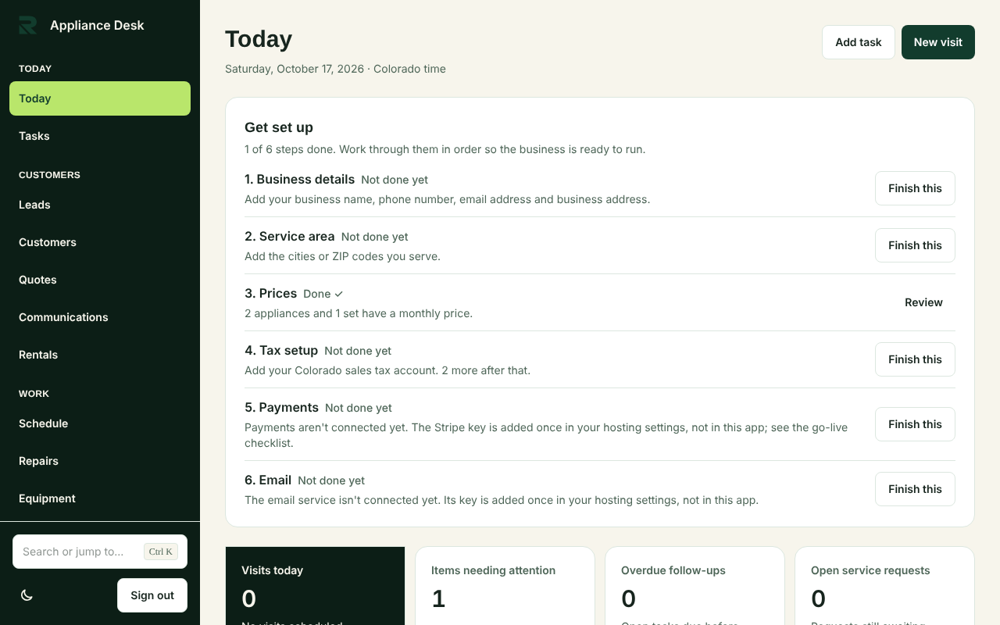

**What it's for.** Today is the first screen to open. At the top an owner-only **Get set up** card lists six steps (business details, service area, prices, tax setup, payments, email) with "Done ✓" or the one thing missing; it only looks and never turns anything on. Below it, **Needs your attention** items say **Urgent** or **Soon**, show the real amount and date when one is known, and open the exact record to fix. On a computer today's visits sit on a day timeline from 8 am to 7 pm with a Now line; on a phone it is a simple list. Money numbers are tagged **Actual** (recorded facts) or **Estimate** (worked out).

Examples of what appears: a new lead ("Contact <name>"), a signed rental ("Schedule <name>'s delivery"), a rental ending in 30 days (choose **Renew**, **Month-to-month** or **Pickup**), a failed card charge with the unpaid dollars, "Returned early — choose what to do", a cleaning step ("Clean (machine)"), tax returns coming due, and unsigned agreements waiting longer than your reminder days.

**Change without code.** Settings → Lead response time, Pickups and deliveries (ending reminder, urgent-after days), Notifications (unsigned-agreement reminder) and Visits and scheduling (usual visit length). **To do list** (`/desk/tasks`) holds your own follow-ups: Team, Mine and Unassigned views, Edit task, Done and Reopen. A task made from a customer or lead stays linked to it.

**If a save or automation fails.** An item that cannot be fixed on its own stays on Today until the cause is fixed; nothing quietly disappears. A save that did not go through shows a red message and keeps what you typed — it never shows "Saved" unless the system confirmed it. If someone else saved a task first, your draft stays on screen; copy it, reload, and apply it.

## Leads

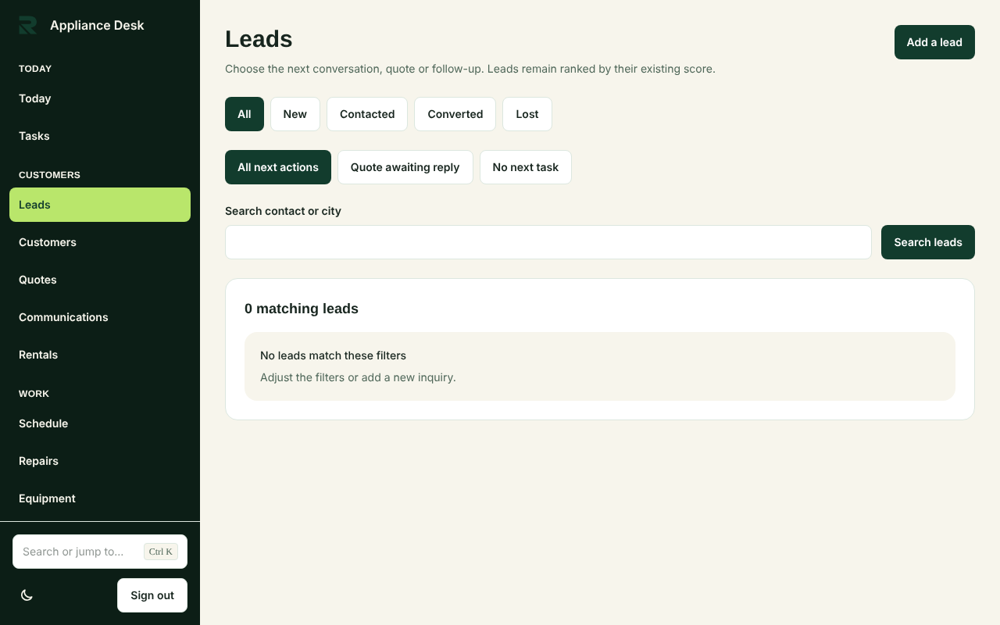

**What it's for.** A website inquiry appears under Leads and you are emailed (high-value leads are flagged). Open it to see what they need, where, and why it scored the way it did. Mark it **Contacted** (you choose the next follow-up date, and that day it returns to Today) or **Lost**. **Convert to customer** creates the account and first service address without retyping; the customer gets an email to set their own password, and you never see a password. After converting, **Create quote** and **Start agreement** are on the lead page. You can also add a lead yourself (owner and admin only).

**Change without code.** Settings → Lead response time, and the lead-scoring rules.

**If it fails.** If the activation email did not arrive, open the customer and press **Resend activation email**; converting twice is refused, so a retry never makes a second account. If an email could not be sent, the conversion still stands and the customer page says the message is still to do.

## Customers

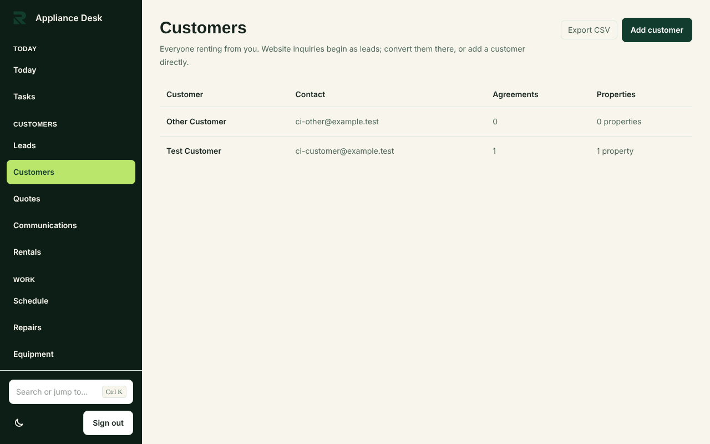

**What it's for.** A customer page has Overview, Properties, Rentals, Service, Billing and Activity. A landlord or property manager can have many properties; add them under **Customers → Add customer** or **+ Add property**, then **New rental here** or **Schedule visit here** carries the address forward. Every main record page has a **Related** box (links to connected pages) and a **History** box (who did what, newest first). **View statement** shows everything the customer owes across all properties.

**Change without code.** Notes, properties, contact details. Customers choose English or Español in their own account.

**If it fails.** A duplicate or conflicting save is refused with a plain message rather than overwriting. For privacy requests see "Backup, restore and privacy".

## Estimates and phone orders

**What it's for.** For a written quote first: **New estimate** (from a lead or from scratch), add lines and an optional deposit, send it. The customer gets a private link to approve or decline; approving a quote with a deposit prompts them to pay it there. A friendly follow-up goes out once if they do not answer. Once approved, **Convert to agreement(s)**; a property manager with several properties gets one agreement per property. **Phone orders** (`/desk/phone-orders`) take an order by phone and send the customer one link.

**Change without code.** Estimate lines, prices, deposit, delivery choices you offer.

**If it fails.** An estimate whose reviewed all-in order changed must be updated before approval. If the activation email cannot be sent after a customer approves, the approval still stands, one account exists, and only the email is retried (proved by `tests/scenarios/07b-estimate-approval-notification.test.ts`).

## Rentals (agreements)

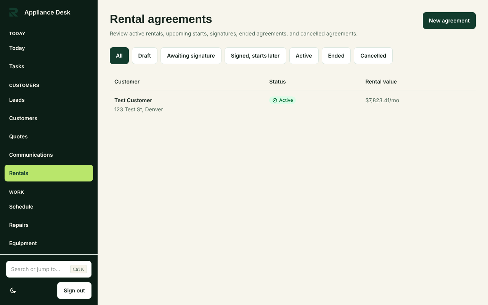

**What it's for.** From a customer, **New agreement**: pick the service address and terms (deposit, damage waiver, late fee, tax rate, month-to-month, 6 or 12 months), add the exact machines (they are reserved at once), then send for signature. The customer reviews on a private link and signs by typing their legal name and ticking a box; the time and address are recorded. A signed agreement becomes **Active**; ending or cancelling frees the machines. The builder keeps a saved draft and a **Resume saved builder** link. A 6- or 12-month term starts when the machines are delivered.

On a draft you can **Prepare this order for signing** (setup fee per delivery address and any down payment). It never charges, books or sends anything, and the amounts are planning figures until the signing steps are completed. At signing, only the owner can record a check or bank transfer received (the exact frozen amount, the date and reference; a repeat returns the original receipt). Owner-only **Signing business clearance** records the CPA or attorney advice you actually received; nothing is approved by default.

Ending: ending a month-to-month rental, early return ("Returned early — choose what to do": keep billing or stop, unused days kept/credited/refunded, early-ending fee as an open bill never charged by itself), cancelling before delivery, term end, renewal and the customer's opt-out. Every ending path creates the same pickup, inspection and cleaning (or repair) chain.

**Change without code.** Settings → Ending and renewing rentals (early-ending fee, notice days, unused-day handling, renewal wording, month-to-month rules). A change applies only to agreements sent after you save; signed agreements keep their terms. The box at the top says in plain words what is switched on and what is still missing.

**If it fails.** A failed Stripe subscription start is recorded and never treated as success; the delivery is still done, the owner gets a To do, and retrying creates exactly one subscription (scenario 2). A connection that dropped with an unknown outcome is held, not repeated — follow `docs/runbooks/UNKNOWN-STRIPE-STATE.md`.

## Visits, dispatch and the driver view

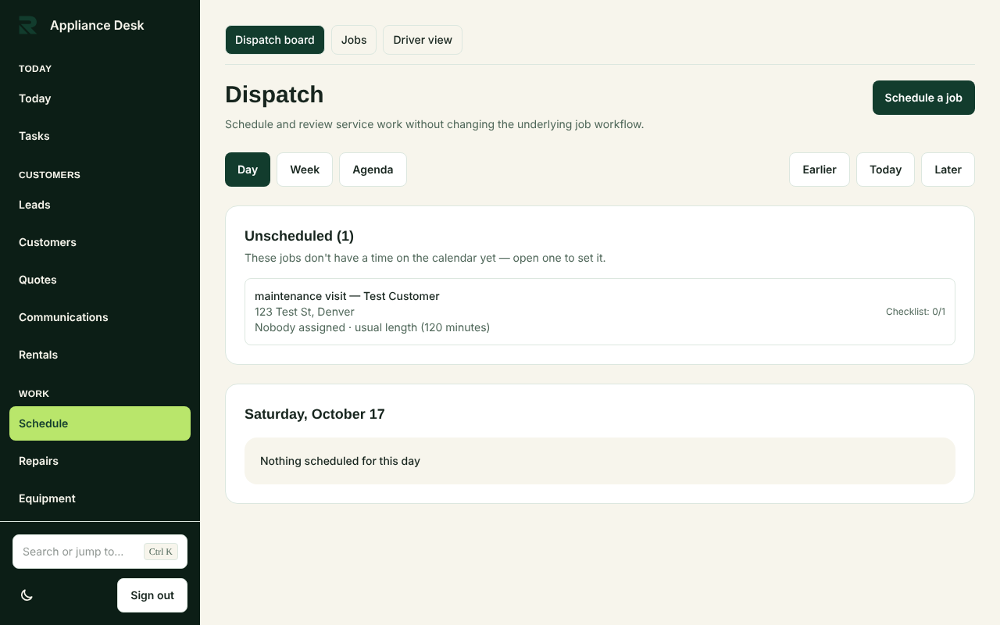

**What it's for.** **Visits** (`/desk/jobs`) schedules deliveries, installs, swaps, removals and maintenance, optionally tied to an agreement (customer and machines fill in). Pick who is doing it and how long (blank uses your usual length); an overlapping visit is shown and you can choose **Book it anyway**. Times are Colorado time. **Nobody was there (no-show)** cancels the visit without changing anything else. **Dispatch** is the board for the day or week. The **Driver view** shows only a staff member's own jobs, with address, machines, notes and photo upload.

**Complete job** asks what happened to each machine (the usual result is pre-chosen) and the date the work was done; billing counts from that date. An item not delivered stays on a list; the customer keeps being billed and is credited for missing days, you can send a different unit, or take it off the agreement and refund it. Taking one machine of a set off bills the remaining machine at its single price from the next day. Marking a machine out for repair with no replacement credits the customer for each day without it. Recording that a late pickup was the company's delay waives the late days.

**Change without code.** Settings → Visits and scheduling (usual length, whether staff may work unassigned jobs) and Pickups and deliveries.

**If it fails.** A completion that cannot be saved keeps every answer on screen. Anything not delivered or not picked up creates a follow-up task for each item so it is never lost.

## Maintenance requests

**What it's for.** Customers submit requests from their account and you are emailed. Mark **Reviewing**, then **Schedule a job for this** to pre-fill the visit; the request follows the visit (Scheduled, In progress, Resolved; a repair not finished or nobody home returns it to Reviewing with a task).

**Change without code.** Request status and the visit it links to.

**If it fails.** A visit that is cancelled or a no-show sends the request back to Reviewing, so it cannot be forgotten.

## Inventory, parts, purchases and suppliers

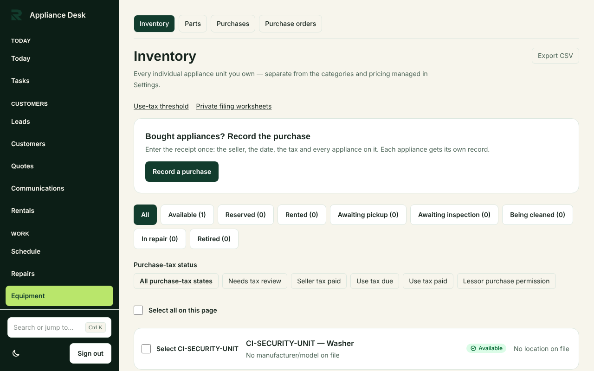

**What it's for.** **Inventory** lists every physical machine with asset number (like WASH-0001, never reused), serial, condition and status. After a pickup a machine goes to **Awaiting inspection**; check each item, and if all pass it goes to **Being cleaned** until you press **Cleaning done** and it becomes Available; if anything fails it goes to repair with a draft repair visit. A saved inspection cannot be edited; add a correction note. The **Who has it** panel shows which customer holds it. **Purchases** records a receipt once with one row per machine (model, serial, price), photos of every page, and the seller's tax split to the cent; the **Audit pack** lists everything you bought in a date range. **Parts** are kept by model with counts; **Suppliers** and **Purchase orders** (Draft, Ordered, Received) add to those counts as shipments arrive. Every count change is written to a permanent history; use **Undo** or **Archive** rather than delete.

**Selling parts (new, off until you use it).** On **Parts**, press **Sell to customers** on a part, type the price you sell it for, and (if you usually buy it to resell) tick "Usually bought to resell". On a new purchase order, a part you sell gets a box "Bought to resell to customers": tick it when you gave the supplier your Colorado resale certificate so you did not pay sales tax (your CPA confirms the exact form). If you later use some of those parts yourself on a repair or install, the app records the use tax for you and lists it under Taxes → Use tax; if your tax address is not set up yet it waits, shows on Today, and is recorded automatically when setup is done. Selling to customers comes in the next update.

**Shop sales (new).** Under **Money → Shop sales** (`/desk/sales`), press **New sale**, choose what is being sold, who it is for (or "Walk-in"), and whether it is picked up or delivered. The sales tax is figured for you: a pickup uses the shop's tax areas, a delivery uses the customer's address. The sale saves as an invoice and the items come off the shelf at the same moment. Open the sale to **record a payment** (cash, check or bank transfer) or, if nothing has been paid yet, **cancel it** and the items go back on the shelf. Selling below the listed price needs a short reason. A sale is refused with plain reasons until you have told Taxes whether "Items sold" and "Used appliance sale" are taxable.

**Retiring an appliance — sell, strip for parts, scrap or throw away (new).** A retired appliance can never be rented again. On its page, **What's next for it?** lets you choose: sell it, strip it for parts, scrap it, throw it away, or donate/other (with a note). You can change your mind until you mark it done. **Strip it for parts** lets you add the parts you kept to your shelf (at $0 each, because their cost is already in what you paid for the appliance) and asks what happened to the rest. The **Retired** tab under Equipment (`/desk/inventory/retired`) lists every retired appliance, lets you mark a truckload done at once, and holds **Scrap money received**: enter each scrap-yard check once for the whole load, not per appliance. It goes in as "Scrap sales" income. Dump fees are an ordinary expense in the "Dump and disposal fees" category. Today shows one reminder when a retired appliance has waited more than 30 days (you can change the number, or enter 0 for never). Choosing a plan changes nothing in your books. Selling a retired appliance through Shop sales is not built yet.

**The tax question has no default.** Only the owner answers it; "I'll check the receipt later" creates a dated To do, and another state's tax creates a CPA question.

**Change without code.** Appliance types and pictures (Settings → Products and pricing), sets and packages, record-keeping years (starts at 7; a receipt a filed return relies on can never be removed).

**If it fails.** A receipt photo that cannot be stored is refused with a plain message and nothing partial is saved. Using more parts than the count shows is refused instead of dropping to zero.

## Expense records and private receipts

**What it's for.** Open `/desk/expenses` from **More → Expenses** or Books. Staff can submit only their own receipts; OWNER/ADMIN review and **Approve and post** source-backed balanced journals. All roles see only their permitted expense history. Submit without paying anybody. A saved expense gets its own verified private receipt upload, and only the submitter or owner/admin can read that attached receipt. A corrected posted expense is **voided with a reason** rather than deleted. Recurring insurance, storage and software templates create review-only drafts on the chosen Colorado day, never automatic money movement.

**Change without code.** Owner/admin can create, edit, pause or reactivate recurring templates and choose expense categories, payment sources and optional appliance/job/purchase links. Staff can only submit; a draft is not a posted journal. `expense-drafts` is a daily 09:50 UTC automation independent of the Stripe balance sync switch.

**If it fails.** Invalid cents, missing vendor/category, inaccessible receipt, inactive team role or stale post version is refused. An existing acquisition amount cannot be silently replaced. Use-tax purchases require the verified business address and reviewed rates; changing a filed tax period requires separate review. Failed draft runs remain visible under System health, and all incomplete changes stay unposted. The private store must be configured correctly before receipt upload; never use the public catalog token for sensitive receipts.

## Books — profit, balance and appliance payback

From **Books → Profit, balance and payback**, choose the Colorado date period and accrual versus cash reporting. Accrual reads the true posted journal income/discounts/expense/depreciation by book date. Cash includes only posted payments attached to a real receipt and an original invoice account/tax allocation; unmatched customer money and deposits are not booked as income. If a source is ambiguous, it appears in the needs-review warning and is excluded from the reported total until reconciled.

The balance screen shows existing checking, card, Stripe/undeposited funds, customer balances, tax/deposit liabilities, equity and retained results. It keeps retired equipment pending disposition as an **asset**, with accrued depreciation netted once. The appliance payback screen divides actual invoiced rent across physical appliances assigned at that invoice period's start, then accounts for sourced repairs; missing costs remain unknown. Remaining payback months at the last six-month rent pace are a **projection**, never guaranteed cash. OWNER/ADMIN can view; STAFF/CUSTOMER cannot access these private reports. This does not file taxes, call banks or pay expenses. Accountant trial reconciliation and CPA IN-39/IN-56 acceptance are separately required.

## Fixed assets, management depreciation and CPA evidence

From **Books → Rental equipment and book depreciation**, OWNER can enroll an existing appliance with a documented positive acquisition cost and explicitly attest an in-service date on or after the Books start date. ADMIN can read; staff/customers cannot access Books. This records management book evidence without moving money or changing the federal tax basis.

The default management straight-line schedule is 60 months and 0% salvage, overridable for new assets; use an individual asset's future-only policy form to change the remaining useful life without rewriting posted journals. **Post depreciation** for completed Colorado months; the ledger uses unique journal events and advances zero-cent months in a durable checkpoint. A complete physical Fleet retirement, followed by the completed depreciation postings, allows OWNER to stage its actual retirement intent and preserve remaining carrying value in the Retired pending disposition **asset** account. This is not sale income, tax gain or a premature disposal loss. Final sale/disposal is a separately approved later feature.

The CPA evidence form records classification, source date/reference, original adjusted-basis inputs, signed adjustments, allowed/allowable depreciation and section 179/bonus separately; UNKNOWN remains a valid state. There is no automatic recapture or income-tax due estimate. CPA decision IN-56 and real-accounting-book reconciliation remain outstanding. Missing acquisition journal, conflicting values, stale form version, missing retirement evidence or completed-month checkpoint fails closed; reconcile the underlying source without editing immutable journals.

## Books cash outlook, customers and year-end files

From **Books → Cash forecast, customer health and year-end**, owner and admin can review three private reports. STAFF and CUSTOMER are refused in the domain and the protected CSV downloads; reporting does not contact Stripe or send an invoice, money, message or tax return.

**Estimated cash outlook (1–180 days).** Only actual ACTIVE agreements with documented recurring billing already started and real nextBillingDate contribute future expected invoice line values. Future tax uses the read-only live Colorado jurisdiction tax engine and acquisition-basis evidence for each projected date. If rules, rates or jurisdictions need owner review, only base invoice amount is shown with an explicit incomplete-tax warning; it is not a guaranteed quote. Active recurring expense templates appear at their upcoming Colorado date unless a matching expense has been created already. Only known OPEN tax-return worksheet totals are represented; an unknown worksheet is flagged rather than assumed zero. Invoices being due never mean customers paid, so use actual banking/reconciliation instead of treating these figures as cash on hand.

**Customer health.** Current active and ending agreements are distinct from closed rentals. Rental length uses supported dates, payments require a successful invoice-applied Receipt and actual refunds are subtracted; account credits, refundable deposits and unapplied money do not create collected cash. Lead source requires a real convertedCustomerId link; otherwise it stays Unknown.

**Five year-end CSVs:** source-backed K-7 monthly separate accrual/cash book profit, management BookAsset and CPA-basis confidence, filed sales/use tax records, expense journal totals by category and **candidate** 1099 vendor spending. The latter uses the owner-configured threshold (currently defaults to $2,000) and only confirmed, payment-account-backed POSTED expenses with a source journal. It does not prove federal reportability, cash method, taxable status or 1099 filing responsibility. The CPA must verify supplier classifications, payment network exclusions and federal rules before any real filings. The downloads are live read-only evidence snapshots, not accountant-certified frozen balances or a replacement for QBO/Xero.

If something is blocked, check Books opening records, recurring template dates, customer payment receipt links and actual filed tax worksheet data. Preserve omissions and source uncertainty for the accountant rather than editing immutable posting evidence.

## Bank observations and typed cash events — K-CASH-1/2

Open **Books → Bank statements and cash records** (`/desk/books/cash`). OWNER registers a real business bank ledger asset (name, institution label, optional four-digit suffix only). No credentials, full account numbers, bank OAuth, invented balance or transfer. OWNER or ADMIN previews/archives settled UTF-8 CSV evidence; STAFF/CUSTOMER are denied. ADMIN cannot change bank source policies, decide ambiguous overlapping transactions or post owner cash events.

To import, select the account, choose a local CSV (5 MiB/10,000 rows maximum), name exact date/description/ID (optional)/amount or debit and credit column headers and choose date format and sign. **Preview** displays the first 20 sanitized observations, inflow/outflow totals and overlap alerts. The 30-minute signed preview binds current user, bank revision, raw file hash and mapping; commit revalidates all. OWNER explicitly resolves ambiguous equal-fingerprint rows and states a reason before correcting an existing interpretation of the same file. Old mappings and observations survive as auditable inactive evidence. An imported row is **not** reconciled cash and cannot fund a budget. Private PDF/image statements use separate bank-account-scoped storage, protected by linked record and current owner/admin rights.

OWNER can journal six typed sources: owner contribution (To bank), owner draw (From bank), bank-to-bank transfer (different From/To), actual bank interest (To bank), card payment (From bank) and cash/check deposit (To bank with exact unique settled Receipt IDs). Select a real date/amount in dollars and source reason; the code stores cents, journals balanced lines in Books, and appends a new reasoned reversal for corrections. It does **not** send money to a bank or create an arbitrary manual journal. Already-closed month controls remain in effect. K-CASH-3 supplies matching, reconciliation and real cash readiness; no owner/provider acceptance is implied by passing source CI.

## Accounting exports

**K-CASH-6 QuickBooks delivery.** On the Accounting exports page, QBO defaults to DETAIL because daily summaries combine journals and can prevent individual bank matches. DAILY_SUMMARY is advanced and requires explicit acceptance of that risk. Enter the exact company or trial-tenant label and edition (Other when not verified); do not enter credentials. After generation, the existing AccountingDelivery table labels a QBO file **PREPARED**, not remotely imported. For a historical QBO CSV, the OWNER registers its actual company first; the old import outcome remains unknown. Any PREPARED or legacy overlapping journal stops another QBO CSV regardless of date window or the only-new checkbox. Do not bypass it when a remote upload might have begun.

**OWNER review steps.** Import DETAIL into a trial QuickBooks company through Settings → Import Data → Journal Entries, mapping Journal No, Journal Date, Account, Debits, Credits and Description and matching exact Parent:Subaccount names. Independently confirm source-journal count, debit and credit balance, individual bank matching and a statement beginning/ending comparison, then save a private trial-company evidence reference and the outcome. ADMIN may inspect and prepare CSV but cannot attest import. Mark **FAILED BEFORE IMPORT** only with evidence no upload started; if uncertain, keep PREPARED and inspect the remote trial company rather than create a duplicate. **IMPORT CONFIRMED** excludes those journal sources from later QBO exports and offers safe re-download with an Already imported warning; reconciliation confirmation preserves a further owner proof. This is not an API connection, payment, full remote attestation or CPA approval. A Free QBO trial has no assumed journal import capability.

**What it's for.** Open `/desk/books/exports` from **Books → Export to QuickBooks, Xero or CSV**. Choose your target, date range, **Journal detail** or **Daily summary**, and whether to include only journal sources not already exported to that specific target (Xero, generic CSV and cash movement exports only; QBO ignores that checkbox when determining uncertain or imported sources). An export is a stored, SHA-256-verified snapshot: re-downloading it later returns the original file, not current edited account names. This does not connect to an accounting provider or send any money. Only active owner/admin users can view or create files; staff cannot access these internal books.

**Change without code.** First open `/desk/books` and map every account to the exact QuickBooks account name (use `Parent:Subaccount` for subaccounts), Xero account **code**, or the recipient's intended generic account label. Confirm the applicable Xero tax-rate names. Mapping cash-movement accounts is also available in Books under Export to → **Cash movements**. For Xero, enter a rate name or leave the new optional rate field empty for **Tax Exempt**; the organization may require another approved tax-rate label. Choose the export period and format on the export screen. The daily summary nets debit/credit movements by day/account; detail keeps separate source journal numbers. Cash movements show payment-account changes with an opposite category. For Xero/generic/cash, **Only not yet exported** checks this specific target, not other targets. For QBO, imported sources are excluded regardless of that checkbox, and uncertain overlapping exports are always blocked.

**Trial-company import steps (required before real accounting acceptance).** In a disposable QuickBooks Online trial company, go to Settings → Import Data → Journal Entries, browse the CSV and match its Journal No., Journal Date, Account, Debits, Credits and Description columns to QuickBooks fields. Confirm trial balances and duplicate-journal warnings; never import the same source twice. For Xero, create/check its chart of accounts and any **holding accounts** needed for bank or system accounts, then use the manual-journal CSV import/Conversion Toolbox. Match Narration, Date, Account Code, Tax Rate and signed Amount fields; validate the selected `yyyy/mm/dd` date and trial debit/credit totals. Xero cannot post manual journals directly to some system/bank accounts, so owner/accountant-approved holding-account mappings may be needed. Review the trial journals before using real accounts.

**If it fails.** No file is saved for invalid dates, incomplete source postings, an unbalanced journal or a missing account mapping; return to Books to correct the reason, then retry. A protected download verifies the archived SHA-256 and refuses a missing/corrupt batch. If QuickBooks or Xero rejects the trial import, compare provider-specific account names/codes, posting permissions, dates, tax names and duplicate numbers before attempting real import. These steps are based on current <https://quickbooks.intuit.com/learn-support/en-us/help-article/import-export-data-files/import-journal-entries-quickbooks-online/L4tQBwbs7_US_en_US> and <https://central.xero.com/0/article/Import-manual-journals-using-the-Conversion-Toolbox>; external acceptance remains pending.

## Billing, deposits and statements

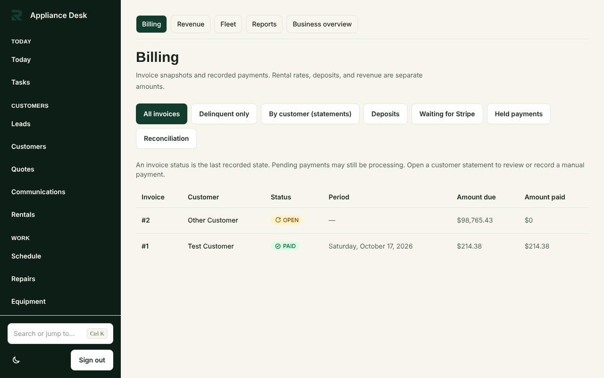

**What it's for.** Rent is charged through Stripe, agreement by agreement. **Billing → Statements** lists every customer with a balance; a statement groups invoices by property and has a CSV. **+ Record payment** records a check, cash or bank transfer (leave "Apply to" on all open invoices, oldest first, for one check covering several); extra becomes account credit. **Write off** marks an uncollectible invoice without deleting it. **Send payment link** shows you the exact message first (or **Copy link**); **Take payment by phone** opens Stripe's own page. **Deposits** lists what you hold and have not decided; **Decide** gives it back in full or in part with a written reason. **Money decisions** on an invoice lets you refund or pay with account credit, and every decision repeats the amount in dollars and words for you to tick. **Waiting for Stripe** shows requests Stripe has not finished; there is nothing to press, the system retries every night. **Held payments** needs your review. Late fees are added once a day using each agreement's own terms and are never charged to a card automatically, and never while a bank payment is being confirmed.

**Bank payments.** A customer who pays by bank transfer waits up to 4 banking days. The bill shows **Being confirmed** (Bills has its own tab for these); it is not counted as paid and not chased as late, and no late fee is added meanwhile. Nothing for you to do. If a bank payment is still waiting after your number of banking days (**Settings › Bank payments**, starting value 6, with **Restore recommended**), a calm item appears on Today. If Stripe says it cleared but it isn't on the bill, press **Record it now** (Today, or Billing › Reconciliation › Bank payments Stripe says cleared); it records once even if pressed twice.

**Late fees.** One rule for every rental: a fee only when a bill is more than 10 days late (the fee day is day 11), at most $15, once per late bill. The customer is warned first: a few days before the fee day (**Settings › Late fee warning**, starting value 2) they get a message with the amount and the date. No delivered warning, no fee. If the warning could not go out, Today shows "No late fee for … — they weren't warned yet" and the bill page offers **Send the warning**, **I told them by phone**, or **Skip the fee** (with a reason). A fee is never added to the bill the customer is paying and never while a payment is in progress (a bank payment being confirmed, or a phone payment just started); if that payment fails, the customer is warned again and the fee day moves. The fee is its own charge, put on the customer's **next** bill (or on a separate one-line bill if the rental ended), and the bill page says "Late fee will be added to the next bill on …". Waive it any time with a reason (before it is billed it is never billed; after, the customer gets a credit). A customer marked **Active-duty military** (customer page › Account) never gets an automatic fee. Starting values show as "not confirmed" until you confirm them.

**Change without code.** Settings → Rental policies and Products and pricing (fees, tax rate, prices, prepay discounts, the 12-month free-month bonus, payment-link wording). Only agreements signed after the change are affected.

**If it fails.** A failed automatic charge puts the invoice in Delinquent and a **Payment failed** item on Today with the unpaid dollars; the customer can use **Pay now** in their account, a replay never charges or records twice, and the item clears when the payment is applied. For unclear Stripe states read `docs/runbooks/UNKNOWN-STRIPE-STATE.md`; for a provider outage `docs/runbooks/PROVIDER-OUTAGE.md`.

## Taxes

**What it's for.** Money → Taxes has four tabs: **To file**, **Use tax**, **Rates & areas** and **Setup** (including customers who do not pay tax, what gets taxed, the audit pack and record keeping). Each return starts with one line, "File and pay $X on Colorado's sales tax website (SUTS) by <date>" with an Open SUTS button, then the numbers to copy in order (use tax follows the DR 0252 form). Press **I filed and paid it** with the date and confirmation number once you have. Appliance Desk never files or pays for you. Purchase tax on appliances needs your business address confirmed under Setup and your tax-election answers first.

**Change without code.** Filing accounts, rates and areas, tax policy (owner only); administrators can review only.

**If it fails.** An address lookup that is unknown or failed is shown, never guessed. Use tax owed with no filing account raises **Use tax owed with nowhere to file it** on Today. Anything the CPA must decide stays marked as needing review; passing tests never counts as professional sign-off.

## Reports, revenue, fleet and growth

**What it's for.** Every number has a **How this is counted** note: the dates, how it is worked out, whether it is recorded fact or estimate, and a link to the records. **Revenue** shows estimated monthly and yearly rates (from agreed prices, not cash) beside money actually received and refunded. **Reports** shows estimated rent versus rent collected per rental (tax, deposits, fees and shop items on an invoice are left out, and billing months are counted from the same day each month), repairs missing a cost, lead sources and the accounting CSV. **Fleet** shows which machines earn or cost the most. **Growth** lists customers and leads worth a call. A cost you never entered shows as "unknown", never zero and never profit. Profit and loss is not built yet.

**Change without code.** Date filters only.

**If it fails.** If numbers cannot add up on a statement a yellow warning tells you to review the invoices. One open review item: the earnings report counts all paid invoices against rent only (see `docs/LAUNCH-LEDGER.md`).

## Notices, messages and automations

**What it's for.** **Notices** are the formal letters (renewal reminders, month-to-month change notices): each is saved, held until delivered and can be marked delivered by hand while customer email is off. Customer and lead pages have a **Messages** panel with the business template, recipient and the recorded state; "Accepted by provider" is not "Delivered", and "Outcome unknown", "Bounced" and "Suppressed" mean exactly that. **Communications** is the text-message inbox (read, assign, mark reviewed; there is no send button until texting is approved). **Automations** shows whether each scheduled pass is healthy, failing, unknown, never run, paused or unconfigured; "never run" and "unknown" do not mean success. **App feedback** (`/desk/feedback`, owner and admins) collects problems with this app and ideas sent by customers and your team (never appliance repairs): reply, add a team-only note, change the status with a reason, or mark a copy as already reported. New and answered reports appear on To do. Everyone can send one from the "App feedback" link and follow their own reports.

**Change without code.** Settings → Notifications (customer email on/off, message wording and previews), Notice delivery, Languages (Spanish wording and reviews), App feedback (pictures per report, days to reopen). Pausing a rule is audited.

**If it fails.** A send that fails after the change was saved leaves the change done and the message pending. A send whose outcome is unknown is held for a person — never resend it just because a dashboard is down; follow `docs/runbooks/MESSAGE-DELIVERY.md` and `docs/runbooks/PROVIDER-OUTAGE.md`. A reminder past its last day is marked missed and never sent.

## Settings

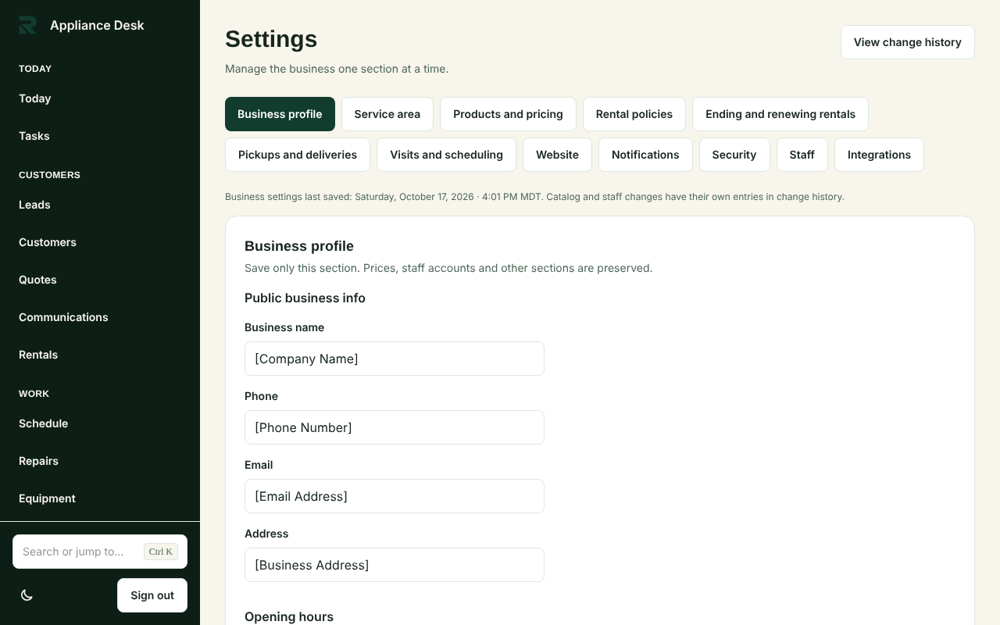

**What it's for.** Settings is divided into sections, each explained on the screen: Business profile (name, address, opening hours, holiday closures, social links, logo), Rental policies (including how long a removed receipt file or an unsent photo waits before it is deleted), Products and pricing (types, sets and packages, prepaid discounts), Ending and renewing rentals, Pickups and deliveries, Visits and scheduling, Notifications, Languages, Lead response time, Payment link wording, team accounts (staff and admin) and the prelaunch setting.

**Change without code.** Everything above. Each setting explains what it does, its starting value and why, who can change it, and offers **restore recommended**. Money is typed in dollars. Changes affect only future agreements and events; signed terms never change.

**If it fails.** A save that is rejected keeps your input and says why. Two people saving at once: the second is told to reload.

**Settings history and undo (new).** At the top of Settings, **Settings history and undo** lists every change to your business settings, newest first, in plain words ("Delivery fee: $45.00 → $50.00, by Chris"). **Undo this** puts one setting back, but only while it still has the value that change gave it. If you changed it again since, the button is replaced by a note saying so. Undo never changes agreements that customers already signed, and it does not touch email, tax, security or agreement-term settings (those are changed on their own screens). **All switches in one place** shows, read-only, whether customer email, text messages, automatic renewals, paused automations, card payments (test or live; the key is never shown), two-step sign-in and the books start date are on, who last changed each one, and a link to where you change it.

**What each admin may do (new).** Under Settings → Team (owner only), **What each admin may do** lists each admin account with seven permissions: record a payment, write off an invoice, settle a held payment, refund or keep a deposit, refund a payment, change business settings, and post or void an expense. All start allowed, exactly as before. **Take this away** limits that one admin on their very next action (they see "ask the owner"); **Give it back** restores it. You always keep every permission, and staff accounts still cannot do any of these. Every change is recorded.

**My account (new).** Under More, **My account** (`/desk/account`) is for you and everyone on your team, and each person sees only their own. You can change your name and phone number, your password (with a box to sign you out on your other devices), and your sign-in email (a link goes to the new address and nothing changes until you open it; the old address is told). You can see the devices you are signed in on and sign out the others, make new backup codes (shown once; the old ones stop working), and turn two-step sign-in off if your role is not required to keep it on. Every change is recorded on Activity, and you get a short email so a change you did not make is noticed. If you forget your password, use **Forgot password** on the sign-in page.

**Approval limits (new).** Under Settings (owner only), **Approval limits** lets you set a dollar amount for write-offs and for posting expenses. When an admin starts one at or above it, nothing happens yet: the admin sees "Sent to the owner for approval", and you get one item on Today. On **Approvals** (`/desk/approvals`) you see who asked, what and how much, and press **Approve and do it now** (it is done as you, and the note names who asked) or **Decline**. If the situation changed meanwhile (for example the invoice was paid), approving changes nothing and tells you why. Requests expire after the number of days you choose (starts at 7). Your own actions never need approval. Every box starts blank, so nothing changes until you fill one in. Refunds, credits and kept deposits are not covered yet.

**Price changes with a start date (new).** Under Settings, **Price changes with a start date** (`/desk/settings/price-changes`) lets you pick an appliance **or a rental set (like a washer and dryer together)**, a new monthly price and a start day (tomorrow or later, within a year). Early that morning, Colorado time, the new price is saved for you the same way as when you type it on the Settings screen, so it shows in the price history and the change history. Rentals already signed keep the price they were signed at, and estimates you already sent keep the price on them; the screen shows how many estimates are open. You can cancel a change any time before its day. If a change can't be applied (for example the appliance was retired, or the admin who scheduled it was since limited from changing settings), the price is left alone, the change shows as "Could not be applied" with the reason, and the problem appears in your system issues; schedule it again once it is sorted out. Sets work the same way: the set price changes on its day, shows in the price history, and signed rentals keep their own price.

**Goals and alerts (new).** Under Settings, **Goals and alerts** (`/desk/settings/goals`) lets you set a target for this month's money collected and for new rentals. The page shows how far along you are and whether you are on pace. If you fall well behind (and it is past the first week), one note appears on Today; it is only a nudge and nothing is wrong with the books. The same page has two warnings you can adjust: appliances that have sat idle (starts at 30 days, 0 turns it off) and low use of your whole fleet (starts off). **Restore recommended** puts both back. Next month's targets start empty. An admin can use it unless you took away "Change business settings".
**Manage my business (new).** At `/desk/control-center` (a button on Settings, and a link on More) you will find everything you can do grouped by what you are trying to get done: website and promotions, prices and agreements, customers and service, equipment, money and taxes, messages to customers, team and permissions, and health. Type what you want in the box (for example "change rent", "fix failed payment" or "stop reminders") and it points you to the right screen and says what it does before you open it. A small "Right now" section shows whether customer messages, card payments, background jobs and approvals need you. If something cannot be checked it says so; it never shows a green check it cannot prove. The page only links; each screen still checks who you are. An admin only sees what an admin may use.

**My workspace (new).** At the bottom of **Manage my business** you can press **Pin to Today** on any card, and your pinned shortcuts appear at the top of Today. You can also save up to 20 filtered views (for example Equipment that is rented, or overdue Tasks) and open them from Today. Only the soft nudges about goals, idle appliances and low use can be hidden from Today; anything about money, deadlines or safety always shows. It is private to you, and it never changes what you or anyone else is allowed to do.

## Website editor

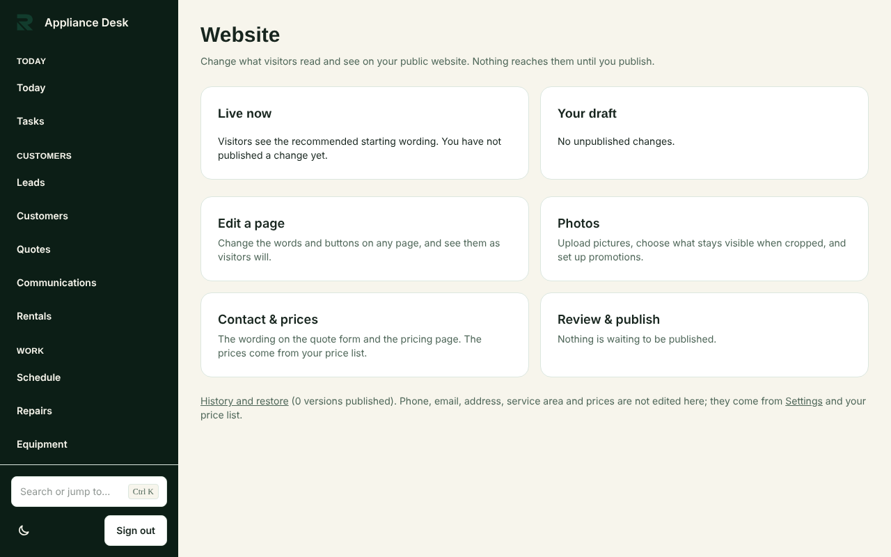

**What it's for.** **More → Website** (owner and admin). Pick a page, a section, then the item; on a computer you see the list, the editor and the real page side by side, and clicking words, a button or the home photo in the preview jumps to it. **Nothing is live until you publish**: *Save draft* keeps work private, **Review & publish** shows each change before and after, every link's destination and the business facts used, and **History** lists every live version (*Put in draft* copies one back; nothing is erased). Facts stay in Settings: type `{phone}`, `{email}`, `{businessName}`, `{city}` and the real values fill in. Links inside sentences are `[words](/pricing)` or `[words](https://…)`. Pictures need a short description (or marked decoration), a focus point and the wide/square/phone crops; promotions have an on/off switch and start and end times in Colorado time. The home heading can highlight a phrase in fresh green. The address check on the home page stores nothing and sends nothing.

**Change without code.** Every word, button, link and picture on the public site except legal wording (privacy, terms, accessibility). Prices, phone, email, address and service area always come from Settings and the price list.

**If it fails.** If someone else published while you were reviewing, nothing is published and you are asked to review again. A broken link or a picture without a description is refused with a plain message when you save and again when you publish. Until the private picture store is switched on for the live site, uploads say "Picture storage is not set up in this environment yet" and the live pictures stay.

## Launch list

**What it's for.** `/launch` is an interest list, not a booking. Add `?utm_source=instagram` or `?utm_source=facebook` to a link to see which brings signups. Before enabling emails enter the mailing address and a monitored inbox, read the three emails shown, tick Enable and save; the first goes on the next daily run and the next two at least 3 and 4 days later. Untick to pause; **Stop emails** removes one person.

**If it fails.** An email marked Needs review may be in progress; check Resend's sending activity before resending anything and do not reset the sequence. "Sent" means the provider accepted it, not that it reached an inbox.

## Backup, restore and privacy

**What it's for.** A backup of the database runs every day with a paired list of the private photos; photos are copied inside private storage under a fingerprint. **Privacy requests** (owner only, `/desk/privacy`) handles a customer asking to see or delete their data: confirm identity, review what must be kept by law or open money, download the export, then fulfil the deletion. Fulfilling writes an audit entry (who, which request, which customer, how many photos) with no personal data. Another customer's data never appears in an export.

**If it fails.** A failed media copy shows in Automations. To recover, follow `docs/runbooks/RESTORE.md` (always into an isolated copy, never over production), `docs/runbooks/STORAGE.md` and `docs/runbooks/PRIVACY-REQUESTS.md`. If a released change makes things worse, follow `docs/runbooks/ROLLBACK.md`: screens roll back, the database never does.

## The customer portal

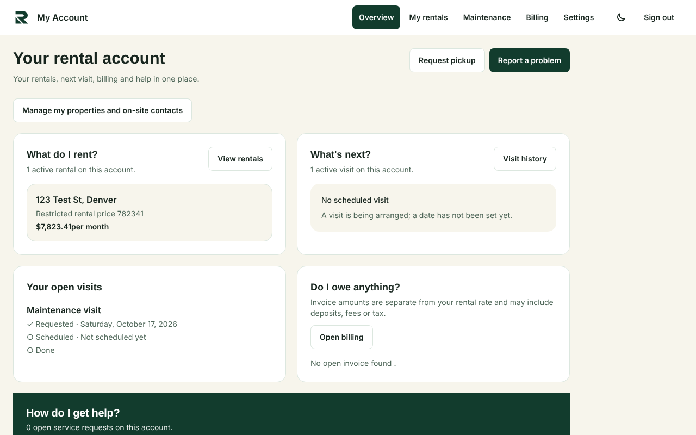

**What it's for.** Customers sign in to `/account` (phone bottom bar: Home, Rentals, Maintenance, Billing, Account). Home answers in order: what they rent, what happens next, whether anything is owed, and how to get help. They can **Report a problem**, **Request pickup** (a request for your review; it does not cancel anything or change billing), see "Your next bill", the status of each visit, sets shown as one set with each machine's number, end a month-to-month rental online, turn off automatic renewal, choose English or Español and text preferences, and **Pay now** on a past-due bill. A customer can only ever see their own records.

**If it fails.** Pay now needs the Stripe keys; until they are live it shows a polite "try again" message. Nothing a customer does can charge or cancel without your review where the rules require it.

## The public website

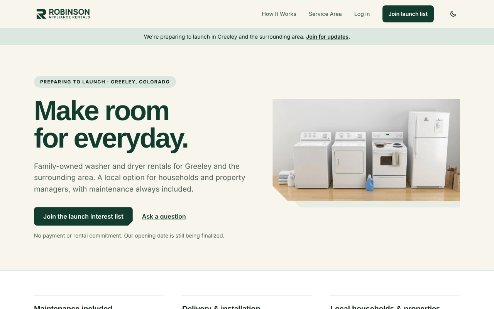

**What it's for.** The home page, pricing, how it works, service area, contact, launch and city pages, plus the legal pages. The home page leads with **Check your address** and **See prices**. If prelaunch mode is on, the launch page replaces the normal homepage and its interest-list workflow stays on. The site follows the visitor's light or dark setting. Words are edited in the Website editor; prices and contact details come from Settings.

**Change without code.** Words and pictures in the Website editor; prelaunch mode, opening hours and contact details in Settings.

**If it fails.** Errors on the live site are reported to Sentry. When you tell a helper what went wrong, say what you clicked and what you saw ("I pressed Save on the pricing page and got a red message") rather than "it broke".

## When changes reach your live site

Work is merged into the development branch only after every automatic check passes. A single daily job then promotes the checked version to the live site. There is no manual release, and no preview site per change, which keeps hosting near $20 a month. A change merged after today's release goes out on the next one.

## Practice data

To clear practice leads, customers, agreements, visits, invoices and payments from a test copy without touching your login, settings, appliance types, fleet or website text, ask your helper to run `npm run db:reset-test-data` (without `-- --yes` it only shows what it would delete). Never run it against real data.

## What is still not live

Real card payments (Stripe is in test mode), customer email, texting (waiting on the carrier registration), automatic renewals, calling and voicemail, and combining a property manager's properties into one charge. The full list of what needs your decision, with the exact steps, is `docs/LAUNCH-LEDGER.md`.

## Books — journal and accounting months

**What it's for.** Open Money > Books. The owner enters a checked accounting start day plus bank, Stripe and card balances once; this creates a journal, not a new payment. OWNER and ADMIN can inspect source-linked balanced journal entries, source dates, accounts, and the unposted-source issue list. The accounting journal may be brought up to date with an explicit button.

**Change without code.** The owner can rename chart labels, add payment-source/expense accounts, map external account names, export a month for review, close a month only after export, and reopen with an audit reason. Late entries stay linked to the original date but post in the next open month. Staff and customers have no access; admins may review and post but cannot reset opening balances or close periods.

**If it fails.** If an invoice, refund, Stripe transaction or tax item lacks sufficient evidence, the journal refuses it and Books shows an item requiring review. A Stripe clearing difference compares yesterday in Colorado with yesterday's imported Stripe data, never a live balance from today. Investigate source evidence before retrying; never make up an allocation or duplicate a payment. If a month cannot close, review/export its entries first. Review CSV is not the final K-5 QuickBooks/Xero import.

**Nightly books (K-3).** The source adds an automated daily read-only Stripe balance import at 09:40 UTC after the backup, with a private clearing check. It is **disabled by default** until separately authorized and configured with `BOOKS_STRIPE_SYNC_ENABLED=true` in the deployment; merely deploying K-3 does not sync the production Stripe account, enable live charges, or accept the books. Failed/incomplete pages keep the old cursor. The existing Books issue list shows review-required clearing differences to OWNER/ADMIN only.

## Budget planning after K-CASH-5A/5B is released (engineering draft — not yet verified)

Open Desk → Money → Budget, then **Plan ahead**. A cost is a projected obligation, never a posted payment, and a target is a savings objective, never bank cash. The owner can enter an EXACT known bill or ESTIMATE, first due day, repeat pattern and envelope; month-end recurrences are calculated from the original calendar anchor (January 31 → February 28 → March 31). The scheduled horizon is bounded by owner settings; refresh dated horizon explicitly when time passes. Existing K recurring expense templates can be linked by their persistent source ID after an envelope has been chosen; a linked bill should not be manually recreated in parallel.

Choose a savings target per discretionary envelope. Monthly spend capacity, save-by-date and maintain-balance needs are calculated from saved cash and unpaid bills without adding the same obligation twice. The allocation preview proposes virtual envelope movements only against independently confirmed, source-current, unprotected checking cash. It never touches bank accounts. OWNER alone can confirm; ADMIN reads, STAFF sees only permitted label words. If a source changes between review and confirmation, the reviewed move refuses.

To mark a planned bill paid, first post an ordinary verified Books expense in Desk → Expenses; then link its unique posted Expense ID and actual whole-cent amount to the occurrence. Part payments may come from distinct posted sources and cannot exceed the original obligation. For an incorrect source link, use the original link's reviewed correction; the original and inverse are both preserved, and no posted K journal is rewritten by a budget correction. If a journal is voided, independently check its linked budget occurrence and correct the planning link. Receiving ordered inventory is NOT bank-payment proof.

Books → Cash outlook displays two separate estimate tracks: **No new collections**, beginning with independently reconciled checking balance less unpaid upcoming costs, and **Expected collections**, which adds future rental invoice estimates but never portrays them as collected. If statement or other proof is unavailable, results are marked Unknown. Neither forecast authorizes spending or displaces Books financial reports. Today may show unpaid bills, shortages and stale banking evidence; open the Budget source screen to resolve them. Actual bank statements, bank-opening composition, tax/card/customer liabilities, accounting import, owner start date and CPA-reviewed treatment remain external activation checks. Do not activate the default-OFF cash budget or customer/provider services based on test/CI alone.

**Team (new).** **Settings → Team** lists you, your admins and your staff (access level, whether two-step is on, when they last signed in). To add someone, fill in **Invite a team member** (name, email, optional phone, Staff or Admin). They get an email with a link that works once for 7 days (you can change that under **Invitation rules**, 1 to 30 days) and choose their own password; their account does not exist until they do. **Send again** makes a new link and the old one stops; **Cancel invitation** stops it. If the screen says the email was not sent, use Send again; do not invite them twice. Only you can invite or make an admin, and you tick which admin permissions they start with. Admins can invite staff only if you turn on **Admins may invite staff**. **Make admin** / **Make staff** signs that person out and emails them. **Remove access** signs them out everywhere and **Restore access** brings them back. You cannot remove or change yourself.

**Sign-in codes (new).** When someone sets up two-step sign-in (**Desk → Settings → Security → Set up**) they choose an authenticator app, a **text message code** or an **email code**, whichever you allow for their level. Under **Settings → Security → How each access level may get its second step** you tick what each level may use; the authenticator app is always allowed, and the starting value gives you and admins authenticator or text, and staff all three. Email codes are weaker for you and admins (the forgot-password link goes to the same email), which is why they start off for you. **Text codes are off** until you tick **Send sign-in codes by text** (separate from customer texting; it only works on the live site once the phone-provider keys are in place). On **My account → Second step** a person checks their phone with a text code and can switch between text and email by proving a code from the new method. At sign-in, a **Text or email code** tab has "Send me a code"; codes last 5 minutes. If a text cannot be sent, use the authenticator app or a backup code. Changing your rules never signs anyone out: people already on a method keep it and are asked to switch.

**Recovery and notices (new).** If a staff member or admin loses their phone or forgets how they sign in, open **Settings → Team**, find them and choose **Reset sign-in**. They are signed out everywhere, their second step is turned off, and they get an email with a link (works once) to choose a new password; then they set up the second step again. You cannot reset your own sign-in this way or another owner's; keep your backup codes somewhere separate from your phone (the owner steps are in the account recovery runbook). Under **Settings → Security → Wrong passwords** you set how many wrong passwords one account may have (starting value 10 within 15 minutes) before it waits that long; the person is emailed, and Forgot password still works. People on your team now also get a short email, with no sign-in link, after a forgotten-password reset, when sign-in is paused, when they sign in from a new kind of device, and when their second step changes.

**Job roles (new).** Under **Settings → Team → Job roles** you decide which screens a kind of job can open. Four come ready: Driver / technician and Office (staff), Bookkeeper (admin, cannot change business settings) and Manager (admin, everything). Pick a job role for someone in the **Job role** column or when you invite them; they are signed out so it shows at once. A job role can only take screens away: staff can never be given money or settings screens, and people with no job role see everything their level allows, exactly as before. Edit a role to tick or untick screens, **Archive** one nobody uses, or **Restore recommended** to put a starting role back.
