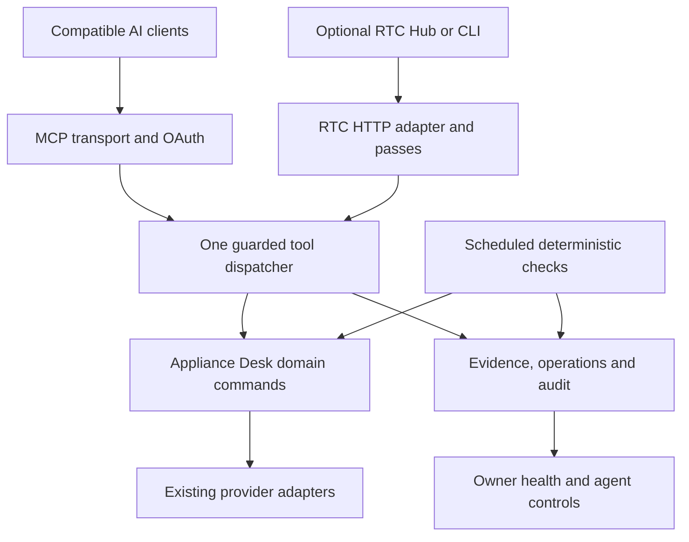

# Architecture and engineering boundaries

## Components

Both network adapters derive the same server-constructed actor context. They never accept roles, business IDs, environment authority or provider credentials from tool arguments. The scheduler dispatches with a stored, owner-approved service delegation; cron authentication alone grants no user powers.

## Module plan (new unless explicitly marked existing)

| Module | Responsibility / dependency direction |
|---|---|
| `src/mcp/catalog.ts` | Versioned tool definitions and schemas; imports narrow domain adapters, never route handlers |
| `src/mcp/dispatch.ts` | Validation, identity, scope, policy, reservation, journal, execute, readback, result filtering |
| `src/mcp/server.ts` | Official SDK transport glue; creates request-scoped server/context; no process-global caller state |
| `src/mcp/rtc.ts` | RTC envelopes, profiles, passes, paging/handles; same dispatcher |
| `src/domains/agent-control/authorization.ts` | Resolve delegation intersection; current role, archive, expiry, revocation and policy checks |
| `src/domains/agent-control/operations.ts` | Durable commands, request-key replay, leases, verification, unknown outcome reconciliation |
| `src/domains/agent-control/diagnostics.ts` | Safe health/readiness DTOs; calls existing health and issue queries |
| `src/domains/agent-control/monitoring.ts` | Rules, schedules, cursors, dedupe, cooldown, heartbeat and delivery outbox |
| `src/domains/agent-control/repair-cases.ts` | Evidence-bound defects/proposals, approved repo linkage and independent verification |
| `src/app/api/mcp/route.ts` | Streamable HTTP GET/POST/DELETE as negotiated; OPTIONS with narrow origin policy |
| `src/app/api/tools/**`, `src/app/api/results/[handle]/route.ts` | RTC wrappers, bounded read-only batch and owned handles |
| `src/app/desk/automations/` (existing) | Health, connection/delegation controls, monitoring and action history; no duplicate dashboard |
| `src/lib/auth.ts` (existing) | Existing login/MFA plus maintained OAuth provider adapter; no public account enrollment |

Do not create `src/app/api/oauth/*` and Better Auth OAuth routes with competing issuers. Expose one canonical issuer in discovery; the RTC compatibility paths delegate to that issuer's maintained handlers. Direct clients use metadata, never guessed route names. Isolate API routing changes from existing `/api/auth/[...all]` behavior through explicit routing tests.

## Three independent authority boundaries

1. **Application operations.** Appliance Desk is the authority for customers, agreements, bills, automation state, staff roles, privacy and operational repairs. Use its commands; never raw SQL, arbitrary HTTP or shell as a tool capability.
2. **Engineering.** The user's coding agent and connected GitHub/Vercel/Neon tools own code editing, CI and releases. This MCP supplies sanitized incident evidence, expected behavior, source revision and verification criteria. It records returned PR/CI/release evidence; it does not gain provider credentials or bypass independent gates.
3. **Infrastructure.** Hosting configuration, storage provisioning, database capacity and provider account controls stay with their service MCPs. Appliance Desk returns configuration names, presence/validity checks and verification instructions, never secret values. An agent with separately delegated infrastructure access can execute supported fixes there and recheck here.

A code repair is not complete because a PR exists. Persist `PROPOSED -> IN_PROGRESS -> PR_OPEN -> MERGED -> DEPLOYED -> VERIFIED`; support `REJECTED`, `SUPERSEDED`, `FAILED` and `BLOCKED`. Mark stages only with actual verified evidence. A repair requiring multiple repositories lists independent permissions and outcomes; no compensating production action is inferred from a failed code change.

## Extensibility and full useful coverage

Start with system health and recovery. A typed registry admits additional application domains through adapters with explicit capability metadata, native command mapping, scope, idempotency and test coverage. Inventory all existing owner/staff/customer settings and actions in MCP-8; each row is IMPLEMENTED, PLANNED, NOT_APPLICABLE (with reason), or MANUAL_PROVIDER_REQUIREMENT. A missing adapter is PLANNED, not a policy refusal. Avoid a generic database or arbitrary command tool to simulate coverage.

Direct connectability and RTC interoperability are different acceptance outcomes. Shipping the authenticated direct diagnostic outcome does not wait for the entire universal Hub. RTC conformance and real optional routing are tracked separately. Host connection stays valid across compatible releases; reconnect only for actual reconsent/revocation/expired authorization, not normal deployment.

## Monitoring and intelligence

The MCP does not contain a mandatory LLM and does not keep an agent running after a chat ends. Deterministic scheduled checks collect safe incidents with leases, suppression and a durable heartbeat. An optional external AI worker, chosen and authorized by the owner, polls/events the MCP, diagnoses and carries out permitted recovery. Record its execution receipt and next expected check. Do not claim a scheduled external worker exists until it actually ran. No paid model is selected or enabled by this plan.

Optimization uses bounded observations (latency histogram, counts, backlog age, error category, query timing with parameters removed) and explicit baseline/window/sample size. Proposals state expected effect, risk, cost known/unknown, measurement plan and rollback. Code/schema/index changes go through normal migrations, review and release. No silent tuning of fees, contracts, legal/tax rules or provider capacity.

## Failure and degraded operation

- Database unreachable: authenticated liveness can report dependency unavailable without needing the database; it never claims delegated reads succeeded. Token verification requiring live revocation fails closed. Health UI and infrastructure logs provide the independent recovery path.
- Application down: external hosting monitoring is required to detect total outage; this server cannot monitor its own absence. MCP-7 defines that external prerequisite without adding paid infrastructure.
- Long action: acknowledge a durable operation ID and poll; do not hold a serverless request open, rely on in-memory tasks, or mark timeout as failure-with-no-effect.
- Stale client schema: unknown names/arguments return actionable version errors; discovery/version reads refresh the catalog. Test client cache behavior rather than promising notifications alone fix every host.
- One failed provider cannot erase the original incident, prevent recording the operation, or send duplicate customer effects on retry.
