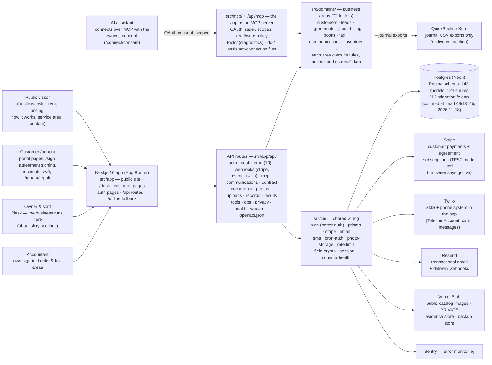

# Relational map — Appliance Desk

How the whole system connects, in plain diagrams. This is the readable
system map required by the fleet rule adopted 2026-11-18 (see
`docs/RULES.md`). It describes the system **as built** — the root
`README.md` is the product overview, `docs/STATUS.md` says where the
work stands, `docs/ARCHITECTURE.md` is the architecture record, and
`docs/DATABASE.md` is the plain-English guide to every data model.

Last refreshed: 2026-11-18, from `main` at head `08cf314b`.
Every exact count stated in this map set is listed in
`docs/relational-map/counts.json` and checked against the code by
`scripts/check-map-counts.mjs` in CI (MAP-COUNTS-1), so a count here
cannot drift silently. The 2026-11-18 refresh corrected four counts
from the first survey — domain folders (72, not 69), migration
folders (212, not 57), and the `tests/` and `e2e/` entry counts —
and rewrote the migrations note in `domain-and-data.md`: the two
models the first survey thought had no migration folder
(`AgentOperation`, `Customer.owedCents`) do have folders on `main`.

## The system in one picture

## How the pieces hold together

- **One business, many hats:** Appliance Desk runs a single business
  (Robinson Appliance Rentals) — it is not multi-tenant. Who may see
  and change what is decided by role: owner, staff with per-area
  capabilities (`StaffCapabilityOverride`, job roles), the outside
  accountant's own sign-in, and customers, who only ever reach their
  own pages and records.
- **The desk is the business:** `/desk` holds the day-to-day —
  customers, leads, estimates, agreements, jobs/dispatch, inventory,
  billing/payments, books, sales tax, communications, reports and
  settings. Screens live under `src/app/desk/` and
  `src/components/` (the shared `kit/` first); the rules behind them
  live in `src/domains/`.
- **Money is integer cents, books are inside the app:** invoices,
  payments, refunds and credits are first-class models, and the app
  keeps its own double-entry books (`LedgerAccount`, `JournalEntry`,
  `JournalLine`, bank imports and matching, budgets) instead of
  depending on an outside accounting system. QuickBooks/Xero receive
  exported journal CSVs — there is no live QuickBooks connection.
- **Tax is a rule book, not a table of rates:** jurisdictions,
  versioned tax rates, official-source watches and taxability rules
  (`src/domains/tax`, `taxben`) feed invoice tax lines and filing
  periods; scheduled crons re-check addresses and watch for rate
  changes.
- **The phone system lives in the app too:** Twilio-backed calling
  and texting are modeled in the schema (accounts, numbers, threads,
  call sessions, usage and statements) under
  `src/domains/messaging` and the communications API — gated on the
  business's texting registration being completed.
- **An AI assistant can connect — as a guest with a key, never as
  the owner:** the app is itself an OAuth-protected MCP server
  (`src/mcp/`, `/api/mcp`). Connections, one-time agent passes and
  every agent operation are recorded (`McpConnection`, `AgentPass`,
  `AgentResult`, `AgentOperation`); scopes and the read/write policy
  in `src/mcp/` bound what an assistant may do, and the owner can
  revoke access. Design record: `docs/mcp/`.
- **Scheduled work is Vercel cron:** 19 cron routes under
  `src/app/api/cron/` are declared in `vercel.json` — billing
  reminders, late fees, collections, renewals, books-nightly, the
  daily backup, telecom sync, tax watches, recall watch and more.
  Each is guarded by `src/lib/cron-auth.ts`.

## Areas

| File | Area |
|---|---|
| [runtime-and-routes.md](runtime-and-routes.md) | Next.js surfaces, desk sections, API groups, auth, cron, tests & CI |
| [domain-and-data.md](domain-and-data.md) | `src/domains/` areas, the Prisma model families and how they relate, migrations |
| [external-connections.md](external-connections.md) | Neon, Stripe, Twilio, Resend, Vercel Blob, Sentry, exports, hosting |

## Running and releasing

- Hosting is Vercel, but `vercel.json` enables git deployments only
  for the `live` and `testing` branches — work lands on `main` and
  is promoted to `live`; a testing copy also runs on the owner's
  development rack (the head commit, #851, points the promotion gate
  at the rack testing instance). The repo-root `README.md` still
  says "main deploys to production automatically", which the
  `vercel.json` in the same repo contradicts — `vercel.json` is the
  behavior to trust. (A fix for the root README's deployment section
  is open as PR #855.)
- The production build is `vercel-build`: it checks migrations,
  deploys them, verifies schema health, then builds. A separate
  `vercel-build:testing` also seeds the testing data.
- CI (`.github/workflows/ci.yml`) runs everything in parallel:
  a secrets scan (always, even for docs-only changes), static
  (typecheck + lint), the Vitest suite split over 3 runners each
  with its own throwaway Postgres, and a production build plus
  Playwright/axe browser tests split over 5 runners, all behind the
  single `ci` gate check. Other workflows: `review-gate.yml`,
  `perf.yml`, `daily-live.yml`, `testing-deploy.yml`,
  `sandbox-publish.yml`, `git-housekeeping.yml`.
