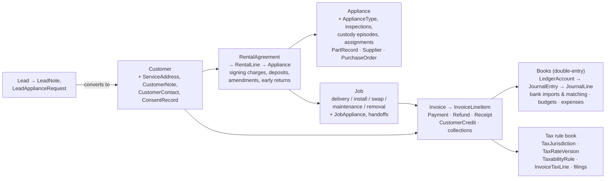

# Domain and data — Appliance Desk

## The domain areas (`src/domains/`)

72 folders (counted at head `08cf314b`, 2026-11-18), one per business
area, plus a shared `pagination.ts`. Grouped here by what they serve:

- **Selling & customers:** `customers`, `leads`, `estimates`,
  `agreements`, `pricing`, `sales`, `referrals`, `growth`, `launch`,
  `site-content`, `preview-storage`.
- **The rental operation:** `inventory`, `jobs`, `delivery`,
  `maintenance`, `orders`, `packages`, `purchasing`, `recalls`,
  `refrigerant`, `vehicle`, `insurance`, `certifications`.
- **Money:** `billing`, `books`, `budget`, `collections`, `disputes`,
  `tax`, `taxben`, `accountant`, `paperwork`.
- **People & access:** `account`, `team`, `staff`, `desk-access`,
  `capabilities`, `approvals`, `security`, `privacy`, `vault`.
- **Talking to customers:** `messaging`, `notifications`, `notices`,
  `portal`, `language`, `feedback`.
- **Running the system itself:** `settings`, `setup`, `connections`,
  `automation`, `backup`, `continuity`, `control-center`,
  `dashboard`, `activity`, `decisions`, `exceptions`, `features`,
  `goals`, `insights`, `reports`, `rules`, `search`, `documents`,
  `stored-files`, `uploads`, `system-issues`, `tasks`, `agent-control`,
  `compliance`, `workspace`.

## The data model (`prisma/schema.prisma`)

243 models and 124 enums (counted from the schema at head `08cf314b`,
2026-11-18). Money is always integer cents; timestamps are UTC and
shown in Mountain Time. The families and how they relate:

- **Auth & people (Better Auth):** `User`, `Session`, `Account`,
  `Verification`, `RateLimit`, `TwoFactor`, `KnownDevice`, plus
  `JobRole`, `TeamInvitation`, `StaffCapabilityOverride` for what
  each person may do, and `StaffTask` for assigned work.
- **Customers & leads:** `Customer` (with the maintained
  `owedCents` total), `ServiceAddress`, `Referral`,
  `LocationPortfolioImport` / `LocationContact` for multi-location
  customers, `Lead` pipeline, language-review and translation-draft
  models for customer wording.
- **Inventory & purchasing:** `ApplianceType`, `RentalPackage` (+
  components), `Appliance` with inspections, amendments, custody
  episodes and assignments; `PartRecord`, `PartStockMovement`,
  `Supplier`, `PurchaseOrder` (+ lines, receipts, receipt tax),
  `Purchase` documents and use tax.
- **Agreements & signing:** `RentalAgreement` and `RentalLine` (+
  amendments), the signing-money chain (`AgreementSigningCharge`,
  `AgreementSigningPayment`, `SigningDownPaymentCredit`,
  `SigningFirstInvoiceApplication`, `SigningPaymentAttempt`),
  setup-fee tax decisions, `PricingRule`, `Deposit`,
  `SignatureRecord`, renewals, early-return and pre-delivery
  cancellation records.
- **Jobs & maintenance:** `Job` (+ `JobAppliance`,
  `JobBillingHandoff`, `PendingDelivery`), `MaintenanceRequest`,
  `Estimate` (+ lines).
- **Billing & payments:** `Invoice` (+ lines and tax lines),
  `Payment`, `Refund`, `Receipt`, `PendingCharge`,
  `BankPaymentInFlight`, `CustomerCredit`, `CreditApplication`,
  `WebhookEvent`, `PaymentDispute`, and collections
  (`CollectionStep`, `CollectionCase`, `SmallClaimsFiling`).
- **Tax & compliance:** `TaxJurisdiction`, `TaxRateVersion`,
  `TaxRateObservation`, `TaxabilityRule` (+ versions),
  `LegalRuleVersion`, `OfficialSourceWatch`,
  `LegalRuleObservation`, address→jurisdiction mapping and
  readiness, `InvoiceTaxLine`, `TaxFilingPeriod`,
  retail-delivery-fee models, `ComplianceProfile`,
  `ComplianceFiling`, `TaxYearFacts`, W-9 requests.
- **Books:** `LedgerAccount`, `JournalEntry` / `JournalLine`,
  `AccountingPeriod`, Stripe balance transactions,
  `Expense` / `RecurringExpense`, `BookAsset`, bank side
  (`CashAccount`, `BankImport`, `BankObservation`, match groups and
  items, `BankReconciliation`, `CashHold`, `BookCashEvent`),
  export batches and account export mappings, and the `Budget*`
  family (plan versions, envelopes, moves, targets, cost plans).
- **Communications / telecom:** `TelecomAccount`,
  `BusinessPhoneNumber`, contact points and bindings,
  `CommunicationThread` / `CommunicationMessage`, `MessageAttempt`,
  `MessageDelivery`, `CallSession` / `CallLeg`, media, templates,
  sync cursors, usage snapshots, cost facts, rate versions and
  statements; plus `ProviderEvent` and `MarketingSuppression`.
- **Platform & operations:** `BusinessSettings`, site content
  (revisions, pointers, assets), launch settings/subscribers,
  `AutomationRun`, `AuditLog`, `SystemIssue` (+ notes),
  `BackupArtifact`, `Photo`, `DocumentArtifact`, business paperwork
  and record files, the credential `Vault*` models and
  `EmergencyAccessRequest`, goals, feedback cases, recall matching,
  safety incidents, insurance policies, fleet vehicles and mileage,
  team certifications, refrigerant records, decisions
  (`DecisionRecord`), notifications and preferences.
- **Assistant connection (MCP/OAuth):** `Jwks`, the `Oauth*` family
  (clients, resources, tokens, consents, assertions),
  `McpConnection`, `AgentPass`, `AgentResult`, `AgentOperation`,
  `OpsAgentKey`, and monitoring (`PerfSample`,
  `OptimizationProposal`, `MonitorRule`, `MonitorRun`,
  `RepairCase`).

## Migrations

`prisma/migrations/` holds 212 folders at head `08cf314b`
(2026-11-18), plus the `DESTRUCTIVE-MIGRATIONS-REVIEWED.json`
approval record. Folder names carry dates, and the names run ahead
of the commit calendar — the newest names are dated 2026-12
(`20261219000000_customer_owed_total`) on a head committed
2026-11-09 — so read the names as labels, not as a timeline.

An earlier draft of this map claimed the schema runs ahead of the
migration folders; re-counting at this head does not bear that out.
The two examples that draft named are both here: `AgentOperation`
has the folder `20261130000000_agent_operations`, and
`Customer.owedCents` has `20261219000000_customer_owed_total`. What
the repo's `check:migrations` gate (run in CI and by every
`vercel-build`) actually polices is destructive SQL patterns in
migrations — drops, truncates, forced NOT NULL — with approvals
recorded in that reviewed file; schema health against a real
database is verified separately at build time
(`db:verify-schema-health`).
