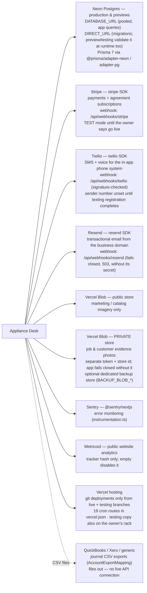

# External connections — Appliance Desk

Wiring as evidenced by `.env.example`, `package.json`,
`src/lib/` and the webhook routes at head `08cf314b` (2026-11-18).
Whether each connection is switched on in a given environment is a
settings question — `docs/GO-LIVE-CHECKLIST.md` and
`docs/STATUS.md` carry the launch state.

- **Database:** Neon Postgres for production (and the Vercel preview
  deployments). The running app connects through the pooled
  `DATABASE_URL` using a Prisma driver adapter (`src/lib/prisma.ts`);
  migrations use the direct `DIRECT_URL` and are configured in
  `prisma.config.ts`, not in the schema. `DIRECT_URL` is not
  migrations-only in practice: preview and testing deployments
  validate both URLs before the Prisma client is created
  (`src/lib/preview-database-safety.ts`, imported by
  `src/lib/prisma.ts`, and `src/lib/testing-environment.ts` check
  both keys), so omitting it there stops the app initialising its
  database client. The canonical testing copy
  is the exception: it runs on the owner's Development Rack against
  the rack's own Postgres (database `appliance_desk`, role
  `appliance_desk_testing`), and that endpoint has no pooled variant
  — both of its URLs use the host directly. The Neon development
  branch stays only as the preview target and rollback target
  (`docs/STATUS.md`, entries dated November 9).
- **Payments:** Stripe is the only card/payment rail — checkout for
  rental payments and subscriptions for agreements, with the signed
  webhook at `/api/webhooks/stripe` as the record of what actually
  happened. Per `.env.example` and `docs/DECISIONS.md` the keys in
  use are TEST mode; live keys wait for the owner's explicit word.
  Stripe balance transactions are also imported into the built-in
  books (`StripeBalanceTransaction`).
- **Phone & texting:** Twilio powers the in-app communications
  (SMS and calls — see the telecom model family in
  `domain-and-data.md`). Webhooks arrive at `/api/webhooks/twilio`
  and are signature-verified. `.env.example` is explicit that
  `TWILIO_PHONE_NUMBER` stays unset until the business texting
  registration/number setup is complete, so texting is wired but
  not live until then.
- **Email:** Resend sends transactional mail (lead and maintenance
  notifications, account mail) from the business's own domain
  addresses; without `RESEND_API_KEY`, lead notifications are logged
  instead of sent and the site still works. The Resend webhook
  verifies Svix signatures and fails closed without its secret.
- **Files & photos:** two deliberately separate Vercel Blob stores —
  a public one for catalog/marketing images only, and a private one
  for operational/customer evidence, which the app refuses to fall
  back from. Backups can use the private store or a dedicated
  `BACKUP_BLOB_*` store; the daily backup cron writes
  `BackupArtifact` records.
- **Accounting software:** no live connection. The books live in the
  app; QuickBooks, Xero and generic formats receive journal CSV
  exports whose account names/codes are mapped in
  `AccountExportMapping`.
- **Assistants:** the one inbound connection of note is not a
  vendor: AI assistants connect to the app's own MCP server
  (`/api/mcp`, OAuth via Better Auth's oauth-provider, consent at
  `/connect/consent`). See `docs/mcp/` and the assistant-connection
  family in `domain-and-data.md`.
