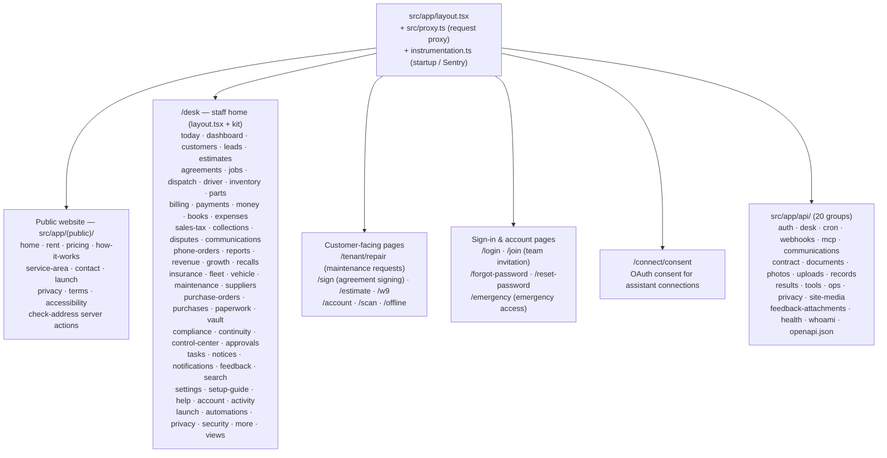

# Runtime and routes — Appliance Desk

Next.js 16 (App Router, TypeScript strict) + React 19, Tailwind 4.
Surfaces as they exist at head `08cf314b` (2026-11-18).

- **The desk** is where the business runs: 62 top-level entries
  under `src/app/desk/` (counted at head `08cf314b`) — sections
  listed in the diagram. Shared UI comes from `src/components/kit/`
  first (fleet rule for this repo: kit components before page-local
  markup), with area components under `src/components/desk/`,
  `portal/`, `site/`, `billing/`, `estimates/`, `jobs/` and `ui/`.
- **Sign-in:** Better Auth (`src/lib/auth.ts`, `auth-client.ts`,
  `/api/auth`) — email/password with email verification, two-factor,
  remembered devices (`KnownDevice`), team invitations (`/join`),
  password email flows, and per-person capabilities and job roles
  deciding what each desk section shows. The accountant gets their
  own sign-in path into the books/tax areas. `/emergency` plus the
  `EmergencyAccessRequest` model cover break-glass access, watched
  by the `emergency-access` and `access-expiry` crons.
- **API shape:** most staff work runs through server actions in the
  desk pages and the `/api/desk` group; `/api/cron` holds the 19
  routes declared in `vercel.json` (billing reminders,
  late fees, collections, billing reconcile, start-renewals,
  job reminders, estimate follow-ups, launch emails, books-nightly,
  expense drafts, scheduled prices, backup, telecom sync,
  tenant retention, tax address re-check, tax rate changes,
  recall watch, emergency access, access expiry), each guarded by
  `src/lib/cron-auth.ts`. Webhooks: `stripe`, `resend`, `twilio`.
  `/api/mcp` is the single-route MCP endpoint backed by `src/mcp/`.
  `/api/openapi.json` publishes the API description; `/api/health`
  and `/api/whoami` are the liveness/identity probes.
- **Startup & cross-cutting:** `instrumentation.ts` /
  `instrumentation-client.ts` run at startup (Sentry wiring lives
  here and in `src/lib/report-error.ts`); `src/proxy.ts` is the
  request proxy; `src/lib/prisma.ts` builds the Prisma client over
  the Neon/pg adapters; `src/lib/schema-health.ts` backs the
  build-time schema check.
- **Tests:** Vitest unit/integration suites in `tests/` (905
  top-level entries at head `08cf314b`) run through the repo's own
  preflight launcher against per-lane local Postgres clusters
  (`npm run test:db`, `test:browser`); Playwright + axe browser
  specs live in `e2e/` (135 top-level entries). Repo-tooling tests ride
  in `npm run check:preflight` and `check:session`. CI shape is in
  the README of this map set (parallel jobs behind one `ci` gate);
  a separate `review-gate.yml` workflow runs the fleet review gate
  on pull requests.
